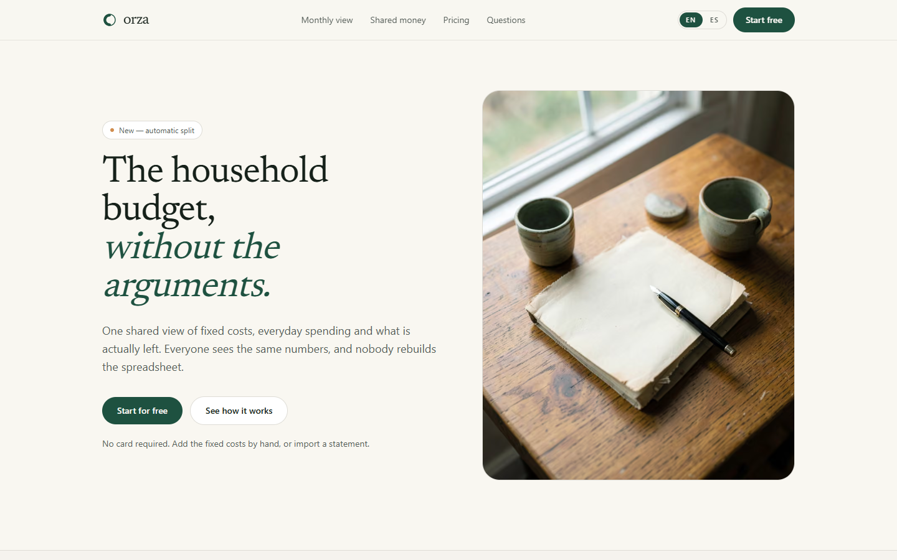

# Orza

Bilingual landing page for a shared household budget, built with Next.js 16, TypeScript and Tailwind CSS v4.



## What it is

A one-page product site in English and Spanish for a fictional household-budget app: fixed costs, split rules and the balance left at the end of the month. It ships the marketing surface only. There are no accounts, no payments and no data storage; the plan buttons and the closing call to action are anchors inside the page.

## Why this instead of a landing template

- Bilingual routing where `en` is the source of truth and `es` is type-checked against it, so a missing key fails `typecheck` instead of rendering a blank label.
- One identity file, `src/config/site.ts`, holds the brand, the public origin, the country, the currency and the time zone.
- Prices are stored in minor units and formatted with `Intl`, so switching language changes the format and never the amount.
- No remote media: three self-hosted photographs, no CDN video, no runtime font request.
- Metadata, canonical, `hreflang`, sitemap, robots, Open Graph image and JSON-LD are generated per locale from the same helpers.
- Small dependency surface: Next, React, two class utilities and one icon set.

## Quick start

Requires Node 24 (see `.nvmrc`).

```bash
npm install
npm run dev
```

| Command | What it does |
| --- | --- |
| `npm run dev` | Development server on `http://localhost:3000` |
| `npm run build` | Production build |
| `npm run start` | Serve the production build |
| `npm run lint` | ESLint with the Next.js rules |
| `npm run typecheck` | `tsc --noEmit` |

## How it is built

### Internationalisation

`src/i18n/dictionaries/en.ts` defines the copy and exports the `Dictionary` type; `es.ts` satisfies it. `src/i18n/get-dictionary.ts` resolves the dictionary for a locale. `src/proxy.ts` reads the `Accept-Language` header, honours the `orza.locale` cookie when it exists and redirects `/` to `/{locale}`.

### Region, currency and prices

`src/config/site.ts` is the only place that knows the country, currency and time zone. `src/lib/format.ts` wraps `Intl.NumberFormat` and `Intl.DateTimeFormat`, and every plan amount is stored in cents in the dictionaries.

### Sections and content

Sections live in `src/components/sections` and receive their copy as props from the page. No visible string is hardcoded in a component: the dictionaries are the single source.

### SEO

`src/lib/seo.ts` builds absolute URLs from `NEXT_PUBLIC_SITE_URL` and exposes canonical and `hreflang` alternates. `sitemap.ts`, `robots.ts` and `opengraph-image.tsx` use the same origin, and the home page emits `Organization` and `WebSite` JSON-LD.

## Project structure

```text
src/
  app/[locale]/          layout, page, not-found, opengraph-image
  app/                   globals.css, icon.svg, robots.ts, sitemap.ts
  components/
    layout/              header, footer, locale switcher
    sections/            hero, values, how it works, features, pricing, faq, cta
    ui/                  cta link, section heading
  config/site.ts         brand, origin, region, currency
  i18n/                  locales, dictionaries, loader
  lib/                   formatters, SEO helpers, class util
  proxy.ts               language detection and redirect
public/images/           self-hosted photography
docs/screenshot.webp     README screenshot
```

## Deployment

The build reads `NEXT_PUBLIC_SITE_URL` for canonical URLs, `hreflang`, the sitemap, `robots.txt` and the Open Graph image. Set it to the production origin before building, for example in the Vercel project environment.

```bash
npm run build
```

## Status and scope

- Verified: production build, `typecheck`, `lint`, both locales, desktop and mobile layouts, canonical URLs, sitemap, robots and the generated Open Graph image.
- Out of scope: backend, authentication, payments, newsletter, form submission. The Vercel Analytics script is the only runtime integration and it only loads in production.
- The brand, the plans and the copy are written for this project; Orza is not a real company.

## License

MIT. See [LICENSE](LICENSE).
